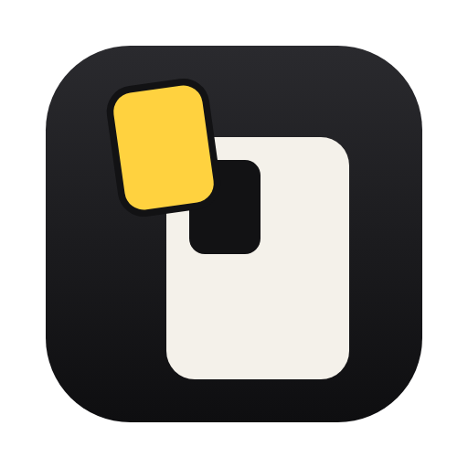
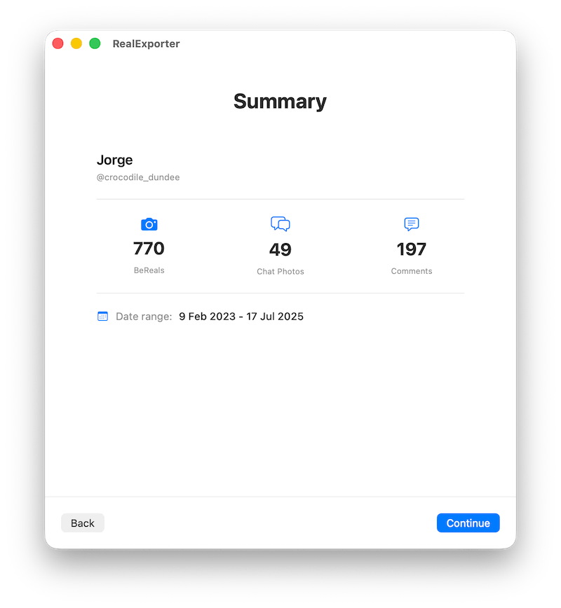
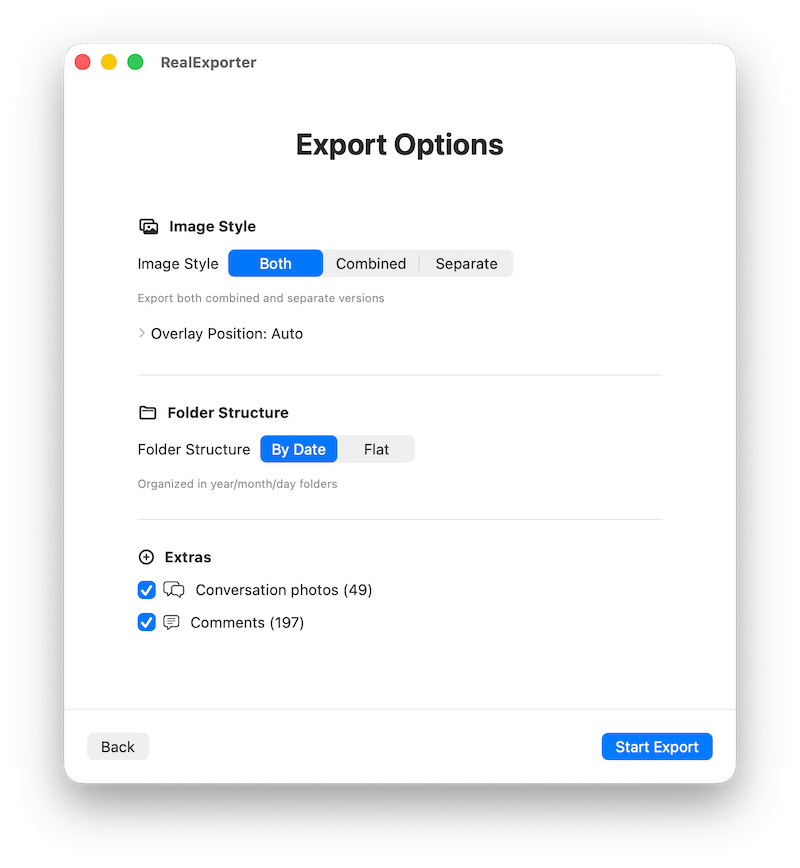

<p align="center">
  
</p>

<h1 align="center">RealExporter</h1>

<p align="center">
  A macOS app to export and convert your BeReal data.
</p>

<p align="center">
  ✨ <a href="https://github.com/jorisnoo/RealExporter/releases/latest">Download</a> ✨
</p>

---

<p align="center">
  
  
</p>

## What it does

- **Photos:** every BeReal as a JPEG with its date, caption and location in the EXIF data. Front camera as an inset (Auto picks the corner that covers the least of the photo), front and back as separate files, or both.
- **Time-lapse:** one H.264 MP4 of your BeReals in order, 1–30 photos per second, with an optional date stamp.
- **Everything else:** video BeReals and behind-the-scenes clips copied as-is, chat photos, and comments in a text file.
- **Options:** a date range, and year/month/day folders or a flat folder.

Everything runs locally. The app sends anonymous usage events via [Aptabase](https://aptabase.com); your photos never leave your Mac.

## Requirements

- macOS 14.0 (Sonoma) or later

## Installation

### Download

Download the latest release from the [Releases](https://github.com/jorisnoo/RealExporter/releases/latest) page.

### Homebrew

```bash
brew install --cask jorisnoo/tap/real-exporter
```

### Build from Source

```bash
git clone https://github.com/jorisnoo/RealExporter.git
cd RealExporter
open RealExporter.xcodeproj
```

Build and run with Xcode 16+.

## How to Get Your BeReal Data

1. Open the **BeReal** app
2. Tap your **Profile** (top right)
3. Tap **Settings** (gear icon)
4. Tap **Help** > **Contact Us** > **Report a Problem** > **Other**
5. Tap **Still Need Help?** > **Select Topic**
6. Select **"I'd like to request a copy of my data"**
7. In the message box, paste the following:

> Hello,
>
> I am exercising my right under Article 15 of the GDPR to request a copy of all personal data you hold about me.
>
> Please provide this data in a portable format (e.g., JSON/ZIP) within the 45-day legal timeframe.
>
> Thank you.

BeReal must respond within 45 days.
They will send you a link in the app: **Help** > **Contact Us** > **Messages**.

You'll receive a ZIP file containing your photos and metadata — that's the file you load into RealExporter.

## Maintainer releases

See [RELEASING.md](RELEASING.md) for versioning, changelog entries and the release command.
